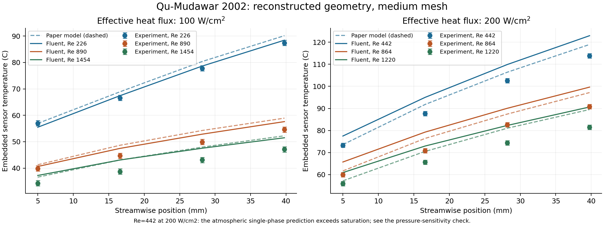

# Microchannel Heat Sink Benchmark — SolidWorks and ANSYS Fluent

A reconstruction of Qu and Mudawar's 2002 single-phase microchannel heat sink, with scripted SolidWorks geometry, conformal hexahedral meshing, and ANSYS Fluent conjugate heat-transfer simulations.

**Main result:** 20 simulations quantify mesh, underside-slot, material-property, and absolute-pressure sensitivities. Baseline and two demanding-point mesh checks pass project criteria; the added checks change channel pressure drop by at most 0.462% and embedded sensor temperatures by 0.189°C. These checks establish numerical verification at tested points. Exact experimental validation remains limited by missing source details and temperature discrepancies.

## Read the project

- [Technical report](docs/technical_report.md): question, methods, results and limitations.
- [Results overview](docs/results_overview.md) and [follow-up investigation](docs/followup_results.md).
- [Reproduction instructions](docs/reproducibility.md): dependencies, commands, software requirements and evidence map.
- [Portfolio and résumé summary](docs/portfolio_summary.md).
- [Milestone status](docs/milestone_status.md).



## What is implemented

- A six-body SolidWorks unit cell: copper, water, polycarbonate cover, and three trapped-air slots; five verified CAD variants and STEP exports.
- A scripted conformal hex mesh independently checked against CAD body volumes and bounds: 54,824 / 171,600 / 438,592 nominal cells.
- Steady, laminar, incompressible, conjugate heat transfer in Fluent 2024 R1; temperature-dependent liquid viscosity and documented constant-property assumptions.
- Six published Reynolds-number/heat-flux pairs, four slot sweeps, three-point baseline mesh study, two demanding-point mesh checks, five property checks and one pressure check (20 distinct saved cases).
- Residual, mass/energy conservation, sensor-stability, and saturation-consistency checks.
- Separate comparisons with digitized experimental symbols and the paper's numerical curves.

## Run

Python 3.12 was used for the recorded simulations. Review dependencies and commands in the reproduction guide.

```sh
python -m pip install -r requirements.txt
python run_analysis.py
python run_validation.py
```

The commands above use supplied compact records and need neither Fluent nor SolidWorks. To run a new CFD case with licensed Fluent 2024 R1:

```sh
python -m pip install -r requirements-simulation.txt
python run_fluent.py --case coarse --threads 1
```

New meshes and runs go to `.generated/`; archived results remain in `results/reference/`. SolidWorks is required only to regenerate CAD; supplied STEP files support meshing independently. Native saved Fluent cases are available in the [v1.0.0 release](https://github.com/rakesh12shankar/microchannel-heat-sink-benchmark/releases/tag/v1.0.0).

## Evidence and limits

The initial low-flow, high-heat case at an assumed atmospheric outlet exceeds local water saturation temperature. Its mathematical single-phase result is retained and flagged. A separate assumed 200 kPa outlet pressure, including the fine-mesh follow-up, passes fluid and water-contact-wall saturation checks; experimental absolute pressure is unreported.

Original sensor differences reach 9.16°C versus digitized experiments and 4.04°C versus digitized paper-model curves; the refined high-heat case differs by 9.34°C and 4.17°C. Digitization uncertainties are assigned separately. The paper's own model differs from its experimental symbols by up to about 8°C in these readings. Material sensitivities explain part of the difference; no parameter fitting was performed.

Channel pressure drop excludes plenum losses. Conditional loss estimates are documented, but missing plenum dimensions prevent exact hydraulic validation. Underside slots, property-reference temperatures, and outlet pressure include explicit reconstruction assumptions.

- [Reference design and assumptions](docs/reference_design.md)
- [Source, pressure and saved-field audit](docs/source_audit.md)
- [Digitization method](docs/digitization.md)

## Sources

Qu, W. and Mudawar, I. (2002). *Experimental and numerical study of pressure drop and heat transfer in a single-phase micro-channel heat sink*. International Journal of Heat and Mass Transfer 45, 2549–2565. [DOI: 10.1016/S0017-9310(01)00337-4](https://doi.org/10.1016/S0017-9310(01)00337-4). [Author-hosted paper](https://engineering.purdue.edu/mudawar/files/articles-all/2002/2002_1.pdf).

Water properties use [CoolProp](https://coolprop.org/fluid_properties/fluids/Water.html). The later source audit confirms the paper's copper conductivity 401 and cover conductivity 0.2 W/(m K). Original copper 400 cases are retained, with a separate correction sensitivity.

## Repository scope

`config/` holds the case matrix and recorded environment; `data/` holds CAD and derived numerical source readings; `docs/` holds methods and interpretation; `results/reference/` holds archived compact outputs, convergence histories and figures. Scripts live at the repository root, matching the organization of the companion [JT microsystem cooling project](https://github.com/rakesh12shankar/jt-microsystem-cooling).

Publisher PDFs, full-text extractions, temporary files, license settings and development transcripts are excluded. Original automation and documentation were prepared with AI assistance and checked against saved solver outputs. No open-source license has yet been selected; public visibility does not itself grant general reuse rights.
